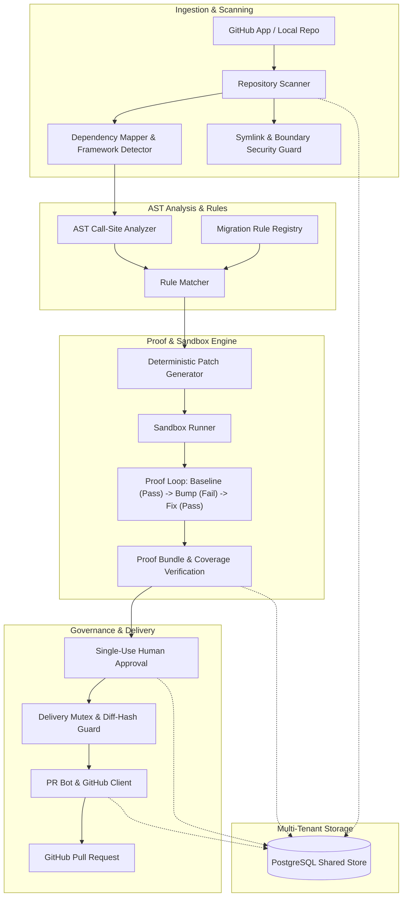

# TryPatchBay — Evidence-First Architecture

## 1. System Overview & Core Philosophy

TryPatchBay is an automated dependency migration platform designed to solve the breaking change upgrade problem in software engineering. Current dependency management tools (such as Dependabot and Renovate) merely bump version strings in manifest files and rely entirely on existing customer CI to catch regressions. LLM coding assistants generate plausible-looking patches but hallucinate API contracts and lack deterministic verification.

TryPatchBay introduces an **evidence-first architecture**:
1. **Detect**: Ingest package changes and classify breaking API transformations.
2. **Map**: Parse source code and lockfiles using static AST analysis to locate all affected call sites with exact file paths and coordinates.
3. **Patch**: Apply deterministic, AST-level transformations for verified migration rules (e.g. parameter renames, API replacements).
4. **Prove**: Execute isolated red-to-green proof loops (Baseline Exit 0 $\rightarrow$ Bump Exit 1 $\rightarrow$ Fix Exit 0) to verify 100% call-site coverage.
5. **Deliver**: Create GitHub pull requests under strict mutex locking, single-use human approvals, and diff-hash validation.

---

## 2. Component Architecture

---

## 3. Subsystem Breakdown

### 3.1 Ingestion & Scanning
- **Path Canonicalization & Safe Reads**: All disk reads (`package.json`, workspaces, lockfiles) pass through `readFileSafely`. Path resolution uses `normalizeRepoRelativePath` with POSIX forward-slash conventions to prevent directory traversal and cross-platform mismatches.
- **Symlink Defense (`assertSafeSymlink`)**: Evaluates realpaths of every path component across directory symlinks, detects dangling links via `readlinkSync`, and detects cyclic symlinks (`ELOOP` $\rightarrow$ `SYMLINK_LOOP_DETECTED`).
- **Framework & Ecosystem Detection**: Identifies React, Next.js, Express, Jest, Vitest, and lockfile formats (npm `package-lock.json`, yarn `yarn.lock`, pnpm `pnpm-lock.yaml`).

### 3.2 Change Classification & Migration Rules
- **Rule Registry (`MigrationRuleRegistry`)**: Holds deterministic migration definitions for breaking API migrations.
  - `lodash-3-to-4`: Replaces deprecated `_.contains(collection, target)` with `_.includes(collection, target)`.
  - `mockpay-1-to-2`: Replaces renamed property `charges.create({ source })` with `charges.create({ payment_method })`.
- **AST Parser & Matcher**: Uses `@babel/parser` and `@babel/traverse` to inspect MemberExpressions, CallExpressions, and ObjectProperties with exact line/column tracking.

### 3.3 Proof & Sandbox Engine
- **Sandboxed Execution**: Isolated workspace copies with environment variable scrubbing (`local-process`).
- **Proof Loop**:
  1. *Baseline*: Run test suite against current dependency version $\rightarrow$ Must exit code 0.
  2. *Bumped (Red)*: Upgrade dependency to target breaking version without patch $\rightarrow$ Must exit non-zero with matching regression error.
  3. *Fixed (Green)*: Apply candidate patch $\rightarrow$ Must exit code 0.
  4. *Coverage Validation*: Verify that all modified files in `fixDiff` match affected call sites.
- **Fail-Closed Gate for Customer Code**: Live customer repositories refuse unisolated host execution; execution is gated to vetted repositories until qualified microVM sandboxes (e.g. Firecracker / gVisor) are provisioned.

### 3.4 Governance, Delivery & Mutex Locking
- **Role-Based Access Control (RBAC)**: Enforces `['owner', 'admin']` permissions on all mutation routes (`POST /api/approvals`, `POST /api/pull-requests`, `POST /api/packages`). Read-only users (`member`, `reviewer`) are rejected with HTTP 403 `FORBIDDEN_INSUFFICIENT_ROLE`.
- **Diff-Hash Pinning**: Approvals cryptographically bind the exact SHA-256 hash of the proposed patch. Any mutation or divergence between approval and PR creation invalidates the approval.
- **Delivery Claims**: Database-level mutex locking ensures a patch cannot be concurrently delivered multiple times.

### 3.5 Storage & Persistence Architecture
- **Production PostgreSQL (`PostgresStore`)**: ACID-compliant storage with relational foreign keys, row constraints, and session revocation indexing.
- **Sliding-Window Rate Limiting (`RateLimiter`)**: Distributed rate limiting on sensitive routes:
  - `POST /api/auth`: Max 5 failed attempts/minute per IP/identifier (returns HTTP 429).
  - `POST /api/scan`: Max 10 scan requests/minute per tenant (returns HTTP 429).
