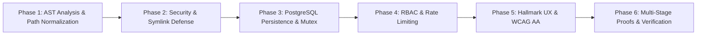

# TryPatchBay — Evidence-First Implementation Plan

## 1. Roadmap & Implementation Phases

The TryPatchBay evidence-first migration engine was engineered across six sequential, verified phases:

---

## 2. Phase-by-Phase Technical Specifications

### Phase 1 — AST Call-Site Analysis & Canonical Path Normalization
- **Challenge**: Windows path separators (`\`) vs POSIX (`/`) caused `fixedSites.filter(site => site.filePath === file)` in `bot.ts` to report "Updates 0 call sites". Furthermore, substring matching (`endsWith('/' + norm)`) allowed file collision bugs across directories (e.g. `apps/a/src/util.js` vs `apps/b/src/util.js`).
- **Implementation**:
  - Implemented `normalizeRepoRelativePath` in `packages/engine/src/sandbox/runner.ts` and exported it via `packages/engine/src/index.ts`.
  - Replaced ambiguous suffix matching with canonical `Set` lookup over normalized POSIX repository-relative paths.
  - Added regression test suite `packages/engine/test/lodash-proof-metrics.test.ts` verifying collision prevention between identical filenames in different subtrees.

### Phase 2 — Security & Symlink Defense
- **Challenge**: Malicious repositories could use directory symlinks or broken external links to escape repository roots during scanning.
- **Implementation**:
  - Enhanced `assertSafeSymlink` in `packages/engine/src/scanner/security.ts` to inspect realpaths of every path component across directory symlinks.
  - Implemented `readlinkSync` evaluation to catch broken symlinks pointing outside repository boundaries.
  - Added loop detection catching `ELOOP` errors (`SYMLINK_LOOP_DETECTED`).
  - Gated all file reads through `readFileSafely` across `packages/engine/src/scanner/repository-scanner.ts`.
  - Created test suite `packages/engine/test/scanner.test.ts` with directory symlinks, broken external symlinks, and safe internal symlinks.

### Phase 3 — PostgreSQL Persistence, Session Revocation & Mutex Delivery
- **Challenge**: Ephemeral serverless storage on Vercel `/tmp` caused state loss and race conditions on multi-node PR delivery.
- **Implementation**:
  - Built `PostgresStore` with connection pooling, transactional boundaries, and automatic DDL schema initialization (`packages/engine/src/db/schema.sql`).
  - Added cryptographic session signing, immediate revocation tracking (`isSessionRevoked`), and delivery claim locking (`acquireDeliveryClaim`).
  - Required `DATABASE_URL` / `POSTGRES_URL` in production; fail-closed rejection of ephemeral fallback in production environments.

### Phase 4 — RBAC & Sliding-Window Rate Limiting
- **Challenge**: CWE-285 missing role enforcement on mutation routes and CWE-307 missing rate limiting on auth and scan endpoints.
- **Implementation**:
  - Expanded `User` model to include `owner`, `admin`, `member`, and `reviewer` roles.
  - Implemented `assertRole` in `packages/site/src/app/api/backend.ts` enforcing `['owner', 'admin']` on `POST /api/approvals`, `POST /api/pull-requests`, and `POST /api/packages`.
  - Created `RateLimiter` (`packages/site/src/app/api/security/rate-limiter.ts`) enforcing:
    - 5 failed login attempts per minute on `POST /api/auth` $\rightarrow$ HTTP 429 `TOO_MANY_REQUESTS`.
    - 10 scan requests per minute per tenant on `POST /api/scan` $\rightarrow$ HTTP 429 `TOO_MANY_REQUESTS`.

### Phase 5 — Hallmark UX & Accessibility (WCAG AA)
- **Challenge**: Hallmark anti-AI-slop audit revealed dead hero form, repetitive `.eyebrow-chip` badges, symmetric 3-card grids, and low-contrast micro-typography.
- **Implementation**:
  - Replaced dead `UpdatesForm` in `packages/site/src/app/page.tsx` with functional CTA buttons (`Start free scan` $\rightarrow$ `/signup` and `View live demo` $\rightarrow$ `/dashboard`).
  - Raised `.small-label`, `.preview-pane p`, and `.muted` font floor to `11px` and darkened text color to `#5e6582` for WCAG AA compliance.
  - Refactored `PageHeading` to default to clean typographic eyebrow labels, reserving `.eyebrow-chip` pills for the primary hero.
  - Added asymmetric `BentoSection` breaking up repetitive 3-card grids.

### Phase 6 — Multi-Stage Proofs & Verification Gates
- **Challenge**: Ensuring proof metrics and demo paths strictly distinguish internal test fixtures from customer-facing repositories.
- **Implementation**:
  - Retained `fixtures/sample-repo` strictly for automated regression testing.
  - Preserved `fixtures/lodash-repo` for genuine multi-stage migration proofs (`npm run prove:real`).
  - Verified that `Nitish-1303/CipherBill` serves as the exclusive YC demo repository with truthful zero findings ("No breaking changes matched the migration rules currently supported by TryPatchBay.").
